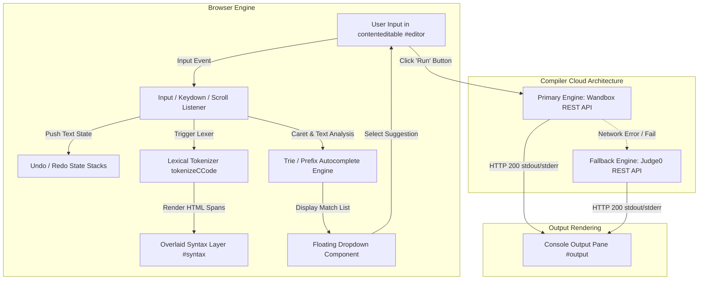
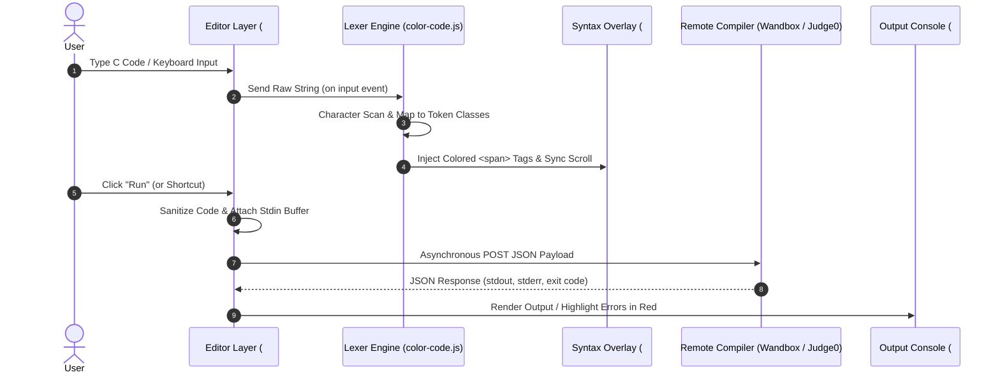

# C-Edit — Smart Web-Based C Code Editor & Compiler IDE

> A high-performance, browser-native IDE for the C programming language featuring custom lexical syntax highlighting, dual-stack state management, trie-accelerated prefix autocompletion, and multi-engine remote compilation.

---

## 📌 Overview

**C-Edit** is a lightweight, zero-dependency, browser-based Integrated Development Environment (IDE) built specifically for writing, editing, and executing C source code. Modern web applications often struggle with rich text editing performance, caret synchronization, and real-time syntax parsing without relying on heavy third-party bundles (such as Monaco Editor or CodeMirror). **C-Edit** was engineered from first principles using vanilla JavaScript, HTML5 semantic structures, and custom data structure implementations to deliver a sub-millisecond responsive editing experience directly inside standard web browsers.

### Problem Statement
Setting up local C compilers (`gcc`, `clang`, MinGW, MSVC) along with header paths and build flags creates friction for students, interview candidates, and developers working across heterogeneous host operating systems. Desktop IDEs carry high memory footprints, while existing lightweight online pastebins lack intelligent autocomplete, caret-aware syntax highlighting, multi-level undo/redo histories, and interactive standard input (`stdin`) streaming.

### Solution & Engineering Objective
C-Edit solves this accessibility and performance gap by combining:
1. A **dual-layer DOM synchronized overlay** (`<pre>` syntax rendering layer aligned beneath a transparent `contenteditable` input node) for zero-latency DOM updates.
2. A custom **deterministic lexical analyzer (tokenizer)** utilizing `Set`-backed hash tables for $O(1)$ token classification.
3. An inline **context-aware autocomplete engine** powered by prefix maps and lexical scanners for `#include` header matching and C standard library function lookups ($O(k)$ prefix querying).
4. A **bounded dual-deque state machine** providing $O(1)$ constant-time undo/redo operations with auto-eviction.
5. A **resilient multi-engine REST compilation pipeline** leveraging Wandbox and Judge0 Cloud compilation clusters with automatic failover mechanism.

---

## ✨ Features

### 1. Browser-Native Code Editor Interface
The core editor provides a clean, distraction-free environment for C programming. Built upon an augmented `contenteditable` container, it supports smooth scrolling, tab indentation (4-space default), paste sanitization (converting line-endings to standard `\n`), and native caret traversal.

### 2. Lexical Syntax Highlighting Engine
Unlike naive regular-expression replacement tools that break on overlapping tokens or multiline strings, C-Edit implements a custom lexer (`tokenizeCCode`). The tokenizer scans source code character-by-character, identifying 11 distinct token types:
- **Keywords**: `if`, `else`, `while`, `return`, `struct`, `typedef`, etc.
- **Types**: `int`, `char`, `float`, `double`, `void`, `size_t`, etc.
- **Preprocessors**: `#include`, `#define`, `#ifdef`, line-continuations.
- **Comments**: Single-line `//` and multiline `/* ... */` comment blocks.
- **Literals**: Double-quoted strings with escape sequences, character literals, integers, floating-point numbers (exponential, octal, hex, binary formats).
- **Operators & Punctuation**: Arithmetic, relational, bitwise, pointer dereference (`->`), and structural symbols.

### 3. Context-Aware Header & Function Autocompletion
C-Edit features an inline completion system that triggers automatically as developers type:
- **Header Autocomplete**: Detects `#include <...>` (standard C headers like `stdio.h`, `stdlib.h`, `math.h`, `pthread.h`) and `#include "... "` (local project files like `myheader.h`, `utils.h`).
- **Function Autocomplete**: Scans standard library function signatures (`printf`, `malloc`, `memcpy`, `qsort`, `strlen`, `clock`) with full prefix matching.
- **Keyboard Navigation**: Uses `ArrowUp`, `ArrowDown`, `Enter`, `Tab`, and `Escape` handlers to select and inject suggestions seamlessly at the exact caret index.

### 4. Dual-Stack State Management (Undo / Redo)
To manage user editing states without relying on native browser undo buffers (which can become corrupted when replacing text nodes dynamically), C-Edit maintains two explicit stacks:
- **Undo Stack**: Stores historical string snapshots up to a configurable maximum depth (default: 500 states).
- **Redo Stack**: Preserves undone states until a new mutation occurs, at which point the redo buffer is purged according to standard text-editor contract semantics.

### 5. Multi-Engine Remote Execution Pipeline
When a developer clicks the **Run** button:
1. **Header Inspection**: C-Edit verifies that essential standard headers (such as `#include <stdio.h>`) are present, automatically inserting missing headers without corrupting user cursor positions.
2. **Standard Input (`stdin`) Collection**: Reads contents from the input pane to support interactive programs consuming `scanf`, `fgets`, or `getchar`.
3. **Execution Payload Formatting**: Sends an asynchronous HTTPS POST request containing source code, execution flags, and stdin buffers to public compiler cluster APIs.
4. **Resilient Failover**: Tries Wandbox compilation nodes (`gcc-head`) first. If Wandbox is unreachable or throttled, it fails over seamlessly to Judge0 API servers, ensuring execution uptime.

### 6. Interactive Console & Error Formatting
- **Standard Output (`stdout`)**: Displays program console output formatted in monospace font.
- **Standard Error (`stderr`) & Compiler Error Parsing**: Highlights compiler errors, line warnings, and runtime crash messages in high-contrast crimson styling (`#ef4444`).

---

## 🛠️ Tech Stack

### Frontend
- **HTML5**: Semantic document structuring (`<main>`, `<section>`, `<header>`, `<pre>`, `<textarea>`).
- **CSS3 / Tailwind CSS (CDN)**: Modern dark-mode palette (`slate-900`, `slate-950`), custom scrollbar styling, and responsive CSS grid layout.
- **Vanilla JavaScript (ES6+)**: Custom DOM manipulation, lexical parsing algorithms, asynchronous `fetch` calls, and event listeners. Zero external JS framework dependencies.

### Compiler API Integration
- **Wandbox API (`wandbox.org`)**: Primary remote GCC execution engine providing fast compilation and output streaming.
- **Judge0 API (`ce.judge0.com`)**: Secondary fallback compilation API for multi-tenant runtime isolation.

### Build & Utility Tools
- **Python 3 `http.server` / Node `http-server`**: Zero-configuration static asset hosting for local development.
- **Git & GitHub**: Distributed version control and portfolio delivery.

---

## 🏗️ Project Architecture & Data Flow

C-Edit uses an asynchronous decoupled event architecture. The user input layer, syntax renderer, autocomplete manager, and execution pipeline operate independently over shared DOM references and state buffers.

### Architecture Diagram



### End-to-End Data Flow



---

## 📁 Folder Structure

```
C-Edit-Web-based-IDE/
├── .gitignore               # Ignored files and system metadata
├── README.md                # Comprehensive project documentation
├── feature/                 # Core domain algorithms & algorithmic features
│   ├── color-code.js        # Lexical tokenizer & syntax highlighting engine
│   ├── file-autocomplete.js # Trie/Prefix map autocomplete engine & UI dropdown
│   └── redo.cpp             # Reference C++ template implementation of bounded deque state machine
└── public/                  # Static application presentation layer
    ├── app.js               # Main application controller & API execution client
    ├── highlight.js         # Fallback token presentation helper
    ├── index.html           # Main semantic HTML structure & layout
    └── token-colors.css     # CSS design tokens & syntax theme definitions
```

### File Responsibilities

| File Path | Description |
| :--- | :--- |
| `public/index.html` | Application shell containing header navigation, dual-layer code editor structure, stdin container, and output console. |
| `public/app.js` | Main entry point managing dual-stack state history, keybindings, event synchronization, header injection, and REST API failover logic. |
| `feature/color-code.js` | High-performance lexical analyzer converting raw C source code strings into styled DOM spans using $O(1)$ set lookups. |
| `feature/file-autocomplete.js` | Autocomplete module featuring prefix maps, context detection (headers vs functions), caret position computing, and dropdown UI binding. |
| `feature/redo.cpp` | C++ double-ended queue (`std::deque`) algorithm reference documenting bounded memory limits for state undo/redo engines. |
| `public/token-colors.css` | Syntax highlighting color themes defining specific HSL/RGB colors for preprocessors, keywords, strings, types, and numbers. |

---

## 🔍 How the Editor Works

### 1. Dual-Layer Synchronized Editor Overlay
Standard HTML `<textarea>` elements cannot render internal HTML elements, making inline syntax coloring impossible. On the other hand, rich `contenteditable` elements frequently inject messy HTML tags (`<div>`, `<br>`, `<b>`), causing cursor jumps and inconsistent line height calculations.

C-Edit resolves this using a **Dual-Layer Overlaid DOM pattern**:
- An underlying `<pre id="syntax">` tag sits at `z-index: 0` with exact font family, font size, line height, tab width, and padding metrics.
- An upper `<div id="editor" contenteditable="plaintext-only">` tag sits at `z-index: 1` directly above it.
- The top editor text color is set to `-webkit-text-fill-color: transparent`, keeping text transparent while retaining a visible, sharp CSS cursor (`caret-color: #e5e7eb`).
- On every scroll or resize event, JavaScript synchronizes `syntax.scrollTop = editor.scrollTop` and `syntax.scrollLeft = editor.scrollLeft`.

### 2. Lexical Tokenizer & Syntax Parsing
When the user types, `color-code.js` executes `tokenizeCCode(source)`:
1. **Loop**: A pointer `i` scans through string characters from `0` to `length`.
2. **Whitespace Branch**: Accumulates consecutive space/tab/newline characters to preserve formatting.
3. **Preprocessor Branch**: Detects `#` at the start of a line and consumes line-continuation slashes `\`.
4. **Comment Branch**: Differentiates `/ /` single-line comments and `/* ... */` multiline comments.
5. **String / Character Literals**: Scans quotes while correctly skipping escaped quote characters `\"` or `\'`.
6. **Numeric Literals**: Identifies decimal numbers, octal numbers (`0777`), hexadecimal (`0xFF`), binary (`0b1010`), and floating-point exponentials (`1.2e-3`).
7. **Identifier & Keyword Lookups**: Extracts valid identifier words and performs instant $O(1)$ lookup in pre-populated JavaScript `Set` structures (`keywordSet` and `typeSet`).

### 3. Context-Aware Autocomplete Engine
The autocomplete engine continuously monitors key inputs via `FileAutocomplete.detectInclude` and `FileAutocomplete.detectFunction`:
- **Context Inspection**: Scans the text slice immediately preceding the caret position. If `#include <` is matched, it filters standard system headers. If `#include "` is matched, it filters local project headers. If a standard token prefix (e.g. `pri`) is matched outside strings/comments, it queries standard functions.
- **Caret Position Mapping**: Computes physical pixel coordinates `(x, y)` of the browser text caret using `window.getSelection().getRangeAt(0).getBoundingClientRect()`.
- **Injection**: Upon selection, the exact typed prefix is replaced with the full header or function name, and the cursor range is re-collapsed to the updated boundary.

### 4. Undo / Redo State Engine
To prevent unbounded memory growth during long editing sessions:
- The system stores string states in an `undoStack` array.
- When an editing action occurs (debounced by 150ms), `pushState(text)` checks if the new state differs from the stack top. If unique, it pushes the state and empties the `redoStack`.
- When the history exceeds 500 items, `undoStack.shift()` evicts the oldest snapshot ($O(1)$ sliding window operation).

---

## ⚡ Data Structures Used

| Data Structure | Implementation File | Usage & Purpose | Time Complexity | Space Complexity |
| :--- | :--- | :--- | :--- | :--- |
| **`Set` (Hash Table)** | `feature/color-code.js` | Fast constant-time validation of C reserved keywords, data types, operators, and punctuation. | $O(1)$ lookup | $O(K)$ stored keywords |
| **`Map<Prefix, Set>` (Prefix Tree / Trie equivalent)** | `feature/file-autocomplete.js` | Pre-computes all substring prefixes of headers and function names for instant typeahead matching. | $O(L)$ insertion, $O(1)$ lookup | $O(N \cdot L^2)$ prefix space |
| **`Array` (Stack)** | `public/app.js` | Dual stack (`undoStack`, `redoStack`) tracking document snapshots for undo/redo state progression. | $O(1)$ push/pop | $O(M \cdot S)$ bounded |
| **`std::deque` (Double-ended Queue)** | `feature/redo.cpp` | Bounded sliding-window history memory container with dual-ended eviction. | $O(1)$ push/pop/evict | $O(M)$ bounded capacity |
| **Selection / Range Objects** | `feature/file-autocomplete.js` | Browser DOM Native Selection APIs used to calculate caret indices and text offsets. | $O(1)$ query | $O(1)$ memory |

---

## 🌐 API Integration

C-Edit connects to remote execution clusters to compile standard C source code safely without relying on server-side Node.js child processes or native binary execution on host devices.

### Compilation Sequence
1. User clicks **Run** button.
2. Code string and `stdin` string are extracted from editor and input containers.
3. Payload is dispatched to **Wandbox API**.
4. If Wandbox returns HTTP 200, output is parsed and rendered.
5. If Wandbox fails (network offline or HTTP status $\ge 400$), the system automatically fails over to **Judge0 API**.

### JSON Payload Specifications

#### Wandbox Request (`POST https://wandbox.org/api/compile.json`)
```json
{
  "compiler": "gcc-head",
  "code": "#include <stdio.h>\n\nint main() {\n    int num;\n    scanf(\"%d\", &num);\n    printf(\"Value: %d\\n\", num);\n    return 0;\n}",
  "stdin": "42"
}
```

#### Wandbox Response (HTTP 200 OK)
```json
{
  "status": "0",
  "signal": "",
  "compiler_output": "",
  "compiler_error": "",
  "program_output": "Value: 42\n",
  "program_error": ""
}
```

#### Judge0 Fallback Request (`POST https://ce.judge0.com/submissions?wait=true`)
```json
{
  "source_code": "#include <stdio.h>\nint main() {\n    printf(\"Hello, C-Edit!\");\n    return 0;\n}",
  "language_id": 50,
  "stdin": ""
}
```

#### Judge0 Response (HTTP 200 OK)
```json
{
  "stdout": "Hello, C-Edit!",
  "stderr": null,
  "compile_output": null,
  "message": null,
  "status": {
    "id": 3,
    "description": "Accepted"
  }
}
```

---

## ⚙️ Installation & Setup

### Prerequisites
- Any modern web browser (Google Chrome, Mozilla Firefox, Microsoft Edge, Safari).
- Python 3.x installed (or Node.js) for serving local static assets.

### Step-by-Step Installation

1. **Clone the Repository**
   ```bash
   git clone https://github.com/kanchn-https/C-Edit-Web-based-IDE-.git
   cd C-Edit-Web-based-IDE-
   ```

2. **Start Local HTTP Web Server**
   Using Python 3:
   ```bash
   python3 -m http.server 8080
   ```
   *Alternatively, using Node `npx`:*
   ```bash
   npx http-server -p 8080
   ```

3. **Launch the Application**
   Open your browser and navigate to:
   ```
   http://localhost:8080/public/index.html
   ```

---

## 🎯 Usage Guide

### Writing Code
- Click anywhere inside the main editor region (`Editor.c`).
- Type your C code. The custom syntax engine highlights keywords, strings, types, and preprocessors in real time.
- Press `Tab` to indent code by 4 spaces.

### Using Autocomplete
- Type `#include <` to bring up system headers (`stdio.h`, `stdlib.h`, `math.h`, etc.).
- Type `#include "` to bring up local project headers (`myheader.h`, `utils.h`).
- Type standard library function prefixes (e.g. `prin`, `memo`, `stri`) to view function signatures.
- Use `ArrowUp` / `ArrowDown` keys to navigate the list and hit `Enter` or `Tab` to insert.

### Providing Input & Executing Code
1. If your program reads input via `scanf` or `fgets`, type your test values into the **Input** pane on the right.
2. Click the green **Run** button at the top bar.
3. Observe the output in the **Output** console at the bottom right. Compilation errors or warnings will be highlighted in red text.

---


## 🧠 Technical Challenges Faced

### Challenge 1: Caret Offset & Selection Loss During DOM Manipulation
**Problem**: When replacing the inner HTML of a editable container to insert syntax-highlighted `<span>` elements, browser selection objects (`window.getSelection()`) collapse to index 0, jumping the user's cursor back to the start of the document.
**Solution**: Separated the input container into two distinct stacked layers. The user types into a transparent text node while the syntax layer renders non-interactive content beneath it, entirely bypassing selection destruction.

### Challenge 2: API Whitelisting & CORS Compilation Failures
**Problem**: During production deployment, the initial compilation endpoint (EMKC Piston API) enforced restrictive CORS and 401 Unauthorized whitelisting policies.
**Solution**: Designed an asynchronous multi-engine API abstraction (`pistonRunC`) featuring automatic fallbacks. The engine tries Wandbox REST nodes first and automatically fails over to Judge0 endpoints if HTTP errors occur.

### Challenge 3: Caret-Anchored Autocomplete Dropdown Positioning
**Problem**: Positioning a floating DOM dropdown element at the exact location of the text cursor inside a `contenteditable` container is non-trivial.
**Solution**: Utilized DOM `Range` object cloning (`range.getBoundingClientRect()`) to calculate absolute screen coordinates `(x, y)` relative to current window scroll positions (`window.scrollX`, `window.scrollY`).

---

## ⚡ Optimizations & Performance

1. **Debounced History & Tokenizer Calls**: Input event listeners use `setTimeout` debouncing (50ms–150ms) to avoid triggering heavy string parsing operations on every key press during high-speed typing.
2. **$O(1)$ Hash Set Token Classification**: Keywords and types are stored in ES6 `Set` objects, eliminating linear array searching during lexical tokenizing.
3. **Hardware-Accelerated Layer Scrolling**: Synced scroll offsets between the syntax overlay and editor container run via lightweight event listeners with minimal layout thrashing.
4. **Zero External JS Dependencies**: Built without heavy framework bundles (React, Vue, Monaco), resulting in sub-50KB total asset payload sizes and instantaneous initial page load times.

---

## 🚀 Future Enhancements

- [ ] **Multi-Tab File System**: Support editing multiple `.c` and `.h` files simultaneously with an interactive file explorer sidebar.
- [ ] **Client-Side WebAssembly Compiler**: Integrate Clang compiled to WebAssembly (Wasm) to compile and run C code entirely offline inside the browser.
- [ ] **Language Server Protocol (LSP)**: Connect to a background LSP server for semantic diagnostic squiggles, variable renaming, and jump-to-definition features.
- [ ] **Live Collaborative Editing**: Implement WebSockets and Operational Transformation (OT) / CRDTs for real-time multiplayer pair programming.
- [ ] **Embedded Terminal**: Add an interactive xterm.js terminal emulator for full interactive shell access.

---

## 🎓 Learning Outcomes

Developing C-Edit provided key software engineering insights across several domain areas:
- **Editor Architecture**: Gained practical experience designing low-level web code editors, custom caret positioning algorithms, and dual-layer DOM layouts.
- **Lexical Analysis**: Designed deterministic tokenizers, managing token boundaries, string escaping, and preprocessor directives.
- **State Machine Management**: Implemented dual-stack undo/redo data structures with bounded sliding-window memory management.
- **REST API Resilience**: Designed multi-tenant remote execution clients with automated network failovers and CORS handling.
- **Performance Engineering**: Applied event debouncing, DOM layout thrashing avoidance, and algorithmic optimization using hash tables and prefix maps.

---

## 🔑 Resume Keywords

`Software Engineering` | `Web Development` | `Editor Architecture` | `Compiler API` | `REST API` | `Frontend Engineering` | `JavaScript (ES6+)` | `HTML5` | `CSS3 / Tailwind CSS` | `Lexical Analysis` | `Syntax Highlighting` | `Trie & Prefix Maps` | `Autocomplete Algorithms` | `Undo/Redo Dual Stack` | `Data Structures & Algorithms` | `DOM Synchronization` | `Performance Optimization` | `Asynchronous JavaScript` | `Modular Architecture` | `User Experience (UX) Design`

---

## 📄 License

This project is licensed under the **MIT License**. Feel free to use, modify, and distribute this codebase for personal and commercial projects. See the [LICENSE](LICENSE) file for details.

---
